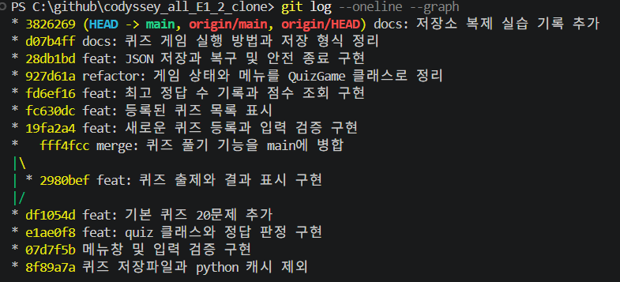

# codyssey_all_E1_2

## 프로젝트 개요

**파이썬과 Git 실전 퀴즈**는 터미널에서 실행하는 4지선다 게임입니다. Python 입력 처리, 반복문, 함수와 클래스, JSON 파일 입출력, Git 명령을 다루는 기본 문제 20개를 제공합니다. 게임에 실제로 사용한 Python 개념과 개발 중에 사용한 Git 명령을 퀴즈로 복습할 수 있도록 이 주제를 골랐습니다.

## 실행 방법

Python 3.10 이상이 필요합니다. 프로젝트 루트에서 아래 명령을 실행합니다. Python 표준 라이브러리만 사용하므로 별도 설치가 필요하지 않습니다.

```powershell
python main.py
```

## 기능

| 메뉴 | 동작 |
| --- | --- |
| 1. 퀴즈 풀기 | 풀 문제 수를 고르면 그만큼 무작위로 출제합니다. 매 답변의 정답 여부와 마지막에 정답 수 및 점수를 확인합니다. |
| 2. 퀴즈 추가 | 문제, 선택지 4개, 정답 번호, 선택 사항인 힌트를 입력해 새 퀴즈를 등록합니다. |
| 3. 퀴즈 목록 | 등록된 퀴즈의 개수와 문제 제목을 확인합니다. |
| 4. 점수 확인 | 완료한 게임 중 가장 높은 점수를 확인합니다. |
| 5. 퀴즈 삭제 | 목록에서 번호를 골라 퀴즈를 삭제하고 저장합니다. `0`을 누르면 취소합니다. |
| 6. 점수 기록 | 완료한 게임의 날짜와 시간, 푼 문제 수, 점수를 최신순으로 확인합니다. |
| 7. 종료 | 아직 저장하지 못한 변경이 있으면 저장을 시도하고 종료합니다. |

힌트가 있는 문제에서는 정답 입력창에서 `0`을 누르면 힌트를 한 번 볼 수 있습니다. 힌트 없이 맞히면 1점, 힌트를 보고 맞히면 0.5점, 틀리면 0점입니다.

필수 입력에서 잘못된 번호나 빈 입력은 안내 후 다시 입력받습니다. `Ctrl+C`나 입력 스트림 종료로 입력이 중단되면 가능한 범위에서 저장을 시도하고 종료합니다.

## 파일 구조

| 파일 | 역할 |
| --- | --- |
| `main.py` | 개별 문제의 출력과 정답 판정을 담당하는 `Quiz`, 메뉴와 점수·저장을 관리하는 `QuizGame` |
| `questions.py` | 첫 실행에 사용하는 기본 퀴즈 20개 |
| `state.json` | 실행 중 생성되는 퀴즈 목록, 최고 점수, 게임별 점수 기록 저장 파일 |
| `.gitignore` | 로컬 저장 파일과 Python 캐시 등을 Git 추적에서 제외하는 규칙 |

## 저장 데이터

`state.json`은 `main.py`와 같은 프로젝트 루트에 UTF-8로 저장됩니다. 퀴즈를 등록·삭제하거나 게임을 완료하면 퀴즈 목록과 점수 기록을 함께 저장합니다.

| 필드 | 저장 값 |
| --- | --- |
| `quizzes` | 각 퀴즈의 `question`(문제), `choices`(선택지 4개), `answer`(1~4 사이의 정답 번호), `hint`(힌트 문자열 또는 `null`)를 담은 목록 |
| `best_score` | 완료한 게임의 최고 점수. 완료 기록이 없으면 `null`입니다. 기존에 저장한 최고 정답 수는 같은 값의 점수로 이어집니다. |
| `score_history` | 완료한 게임의 `played_at`(시간대가 포함된 날짜와 시간), `question_count`(푼 문제 수), `score`(힌트를 반영한 점수)를 담은 목록. 기존 파일에 이 필드가 없으면 빈 목록으로 시작합니다. |

파일이 없으면 기본 퀴즈로 시작합니다. 파일 내용이 손상되었으면 안내 후 기본 퀴즈로 시작하고 다음 저장 시 복구합니다. `state.json`은 Git 추적에서 제외되어 각 로컬 환경에 따로 저장됩니다.

### JSON 저장을 선택한 이유와 한계

기본 퀴즈 20개로 시작하는 1인용 콘솔 게임에서는 JSON 파일 하나로 퀴즈와 점수를 저장하고 내용을 직접 확인하기 쉽습니다. 현재 구현은 시작할 때 파일 전체를 읽어 메모리에 올리고, 변경을 저장할 때 전체 내용을 임시 파일에 다시 쓴 뒤 기존 파일을 교체합니다. 퀴즈나 게임 기록이 쌓일수록 시작 시간, 저장 시간, 메모리 사용량이 데이터 크기에 따라 늘어납니다. 여러 프로세스에서 동시에 실행하면 마지막에 저장한 프로그램의 내용이 이전 저장 결과를 덮어쓸 수 있습니다.

기록 일부를 자주 검색하거나 전체 파일을 다시 쓰는 비용이 커지면 표준 라이브러리의 `sqlite3`로 옮길 수 있습니다. 퀴즈와 게임 기록을 테이블로 나누면 필요한 행만 읽거나 변경할 수 있고, 트랜잭션으로 여러 변경을 함께 저장할 수 있습니다. 그 경우 테이블 구조와 기존 JSON 데이터를 이전하는 절차도 필요합니다.

## 설계와 역할 분리

`Quiz`는 한 문제의 질문, 선택지, 정답, 힌트를 보관하고 `show()`와 `is_correct()`로 그 문제를 출력하고 채점합니다. `QuizGame`은 퀴즈 목록, 최고 점수, 게임 기록을 보관합니다. 메뉴마다 같은 목록과 점수를 사용하므로 상태를 객체에 묶으면 기능을 호출할 때마다 여러 상태 값을 매개변수로 전달하는 일을 줄일 수 있습니다. 함수 중심으로 구성한다면 상태를 매개변수와 반환값으로 주고받아 데이터 흐름을 명시할 수 있습니다. 이 프로젝트에서는 게임 전체에 걸쳐 유지되는 상태를 클래스로 묶고, 게임 상태에 의존하지 않는 입력 검증과 기본 퀴즈 생성은 별도 함수로 두었습니다.

| 책임 | 파일과 함수 | 분리 기준 |
| --- | --- | --- |
| 콘솔 입력 검증 | `main.py`의 `read_number()`, `read_text()` | 숫자 변환, 허용 범위, 필수 텍스트 확인과 재입력을 담당합니다. 메뉴·풀이·등록·삭제가 같은 검증 함수를 재사용합니다. |
| 저장 데이터 검증 | `main.py`의 `Quiz.from_dict()`, `validate_score_history()` | JSON에서 읽은 문제와 게임 기록의 필드, 자료형, 허용 범위를 확인합니다. |
| 파일 입출력 | `main.py`의 `QuizGame.load_state()`, `QuizGame.save_state()` | JSON 읽기·쓰기와 파일 누락·손상·입출력 오류를 처리합니다. 저장 경로나 형식은 이 영역에서 관리합니다. |
| 기본 문제 | `questions.py`의 `DEFAULT_QUESTIONS`, `main.py`의 `create_default_quizzes()` | 기본 문제 데이터를 한곳에 두고 게임에서 사용할 `Quiz` 객체로 변환합니다. |

콘솔 입력이 잘못되면 해당 항목을 다시 입력받고, 저장 파일이 손상되면 시작 단계에서 기본 데이터로 복구합니다. 두 실패를 분리하면 입력 범위를 바꿀 때 파일 처리 코드를 수정할 필요가 없고, 저장 형식을 바꿀 때 메뉴별 재입력 흐름을 그대로 사용할 수 있습니다.

### 요구사항이 바뀔 때 수정할 위치

| 변경 예시 | 수정할 파일과 함수 |
| --- | --- |
| 기본 문제 또는 힌트 내용 변경 | `questions.py`의 `DEFAULT_QUESTIONS` |
| 선택지 개수 변경 | `questions.py`의 기본 데이터, `main.py`의 `QuizGame.add_quiz()`와 `Quiz.from_dict()`를 함께 수정합니다. `Quiz.show()`와 `QuizGame.play_quiz()`는 실제 선택지 길이를 사용합니다. |
| 메뉴 항목 또는 순서 변경 | `main.py`의 `MENU_OPTIONS`와 `QuizGame.run()`의 번호 연결을 함께 수정합니다. |
| 랜덤 출제, 문제 수 제한, 힌트 감점 변경 | `main.py`의 `QuizGame.play_quiz()`를 수정합니다. 점수 범위가 바뀌면 `validate_score_history()`와 기존 기록 호환성도 확인합니다. |
| 점수 기록 필드나 표시 형식 변경 | `main.py`의 `QuizGame.play_quiz()`, `validate_score_history()`, `QuizGame.show_score_history()`를 확인합니다. |
| 저장 파일 경로 또는 저장 방식 변경 | `main.py`의 `STATE_PATH`, `QuizGame.load_state()`, `QuizGame.save_state()`를 수정합니다. 기존 데이터를 불러올 수 있도록 필드 검증과 이전 규칙도 확인합니다. |

## Git 작업 기록과 증빙

### 커밋과 브랜치 병합

- 프로젝트 원격 저장소와 전체 `main` 커밋 이력입니다. [GitHub 저장소](https://github.com/byeongchan/codyssey_all_E1_2) · [커밋 이력](https://github.com/byeongchan/codyssey_all_E1_2/commits/main/)
- `7920191` 시점까지 초기 커밋과 병합 커밋을 제외한 작업 커밋은 **19개**입니다. `git rev-list --count --no-merges 7e0b7dc..7920191`로 같은 범위를 확인할 수 있습니다.
- `main`의 기본 퀴즈 작업(`df1054d`)을 기준으로 `feature/quiz-play`를 만들고, 퀴즈 출제 기능을 `2980bef`에 커밋했습니다. `main`으로 돌아와 `--no-ff`로 병합한 결과 `fff4fcc`가 생성됐습니다. 이 병합 커밋의 두 부모는 기존 `main`의 `df1054d`와 기능 브랜치의 `2980bef`입니다. [기능 커밋](https://github.com/byeongchan/codyssey_all_E1_2/commit/2980befaaf5494533f3b3c6f01c2e82ec8618eed) · [병합 커밋](https://github.com/byeongchan/codyssey_all_E1_2/commit/fff4fcc11e983f61c64985c2ed2a26e2a8051211)

복제 실습 직후에 캡처한 커밋 그래프입니다.



브랜치 생성과 병합은 로컬 reflog에도 남아 있습니다. 아래 두 줄은 각각 `feature/quiz-play`와 `main`의 reflog에서 확인한 항목입니다.

```text
df1054d branch: Created from HEAD
fff4fcc merge feature/quiz-play: Merge made by the 'ort' strategy.
```

퀴즈 출제 기능은 별도 브랜치에서 작업해 `main`에 완성된 기능을 반영할 시점을 분리했습니다. 기능을 확인한 뒤 `main`에서 `git merge --no-ff feature/quiz-play`로 통합하면 개발 커밋과 통합 시점이 모두 그래프에 남습니다. 복제 실습의 `pull --ff-only`는 원래 작업 폴더가 원격보다 뒤처진 상태에서 새 커밋을 그대로 따라잡는 데 사용했습니다.

### 별도 폴더에서 clone·push·pull 실습

원래 작업 폴더의 PowerShell에서 아래 순서로 진행했습니다. 복제본에서 README 한 줄을 추가한 다음 커밋하고 푸시했으며, 원래 폴더에서 `pull`한 뒤 같은 커밋과 README 변경이 반영된 것을 확인했습니다. [복제본에서 만든 커밋 `3826269`](https://github.com/byeongchan/codyssey_all_E1_2/commit/38262693d6bb1b884105e60aeada7fda2e7c15fd)

```powershell
git clone (git remote get-url origin) ..\codyssey_all_E1_2_clone
# 복제본에서 README.md에 실습 문장 한 줄을 추가합니다.
git -C ..\codyssey_all_E1_2_clone add -- README.md
git -C ..\codyssey_all_E1_2_clone commit -m "docs: 저장소 복제 실습 기록 추가"
git -C ..\codyssey_all_E1_2_clone push origin main
git pull --ff-only origin main
```

실습 후 양쪽 저장소의 `git reflog`에서 확인한 항목입니다. 같은 `3826269`가 복제본에서 푸시되고 원래 폴더에 들어온 것을 확인할 수 있습니다.

| 확인 위치 | 실제 기록 |
| --- | --- |
| 복제본 `HEAD` | `d07b4ff clone: from https://github.com/byeongchan/codyssey_all_E1_2` |
| 복제본 `HEAD` | `3826269 commit: docs: 저장소 복제 실습 기록 추가` |
| 복제본 `origin/main` | `3826269 update by push` |
| 원래 폴더의 `main` | `3826269 pull --ff-only origin main: Fast-forward` |

원래 작업 폴더에서 아래 조회 명령을 실행하면 위 기록을 화면에서 다시 확인할 수 있습니다.

```powershell
git -C ..\codyssey_all_E1_2_clone reflog show --format="%h %gs" HEAD
git -C ..\codyssey_all_E1_2_clone reflog show --format="%h %gs" refs/remotes/origin/main
git reflog show --format="%h %gs" main | Select-String '3826269.*pull'
```

### 커밋 단위와 메시지 규칙

한 커밋에는 메뉴 구현, 퀴즈 등록, JSON 저장, 문서 수정처럼 독립적으로 검토할 수 있는 변경을 하나씩 담습니다. 기능과 함께 바뀐 실행 안내는 같은 커밋에 넣고, 다른 기능이나 무관한 파일 변경은 별도 커밋으로 남깁니다. 커밋 전에는 `git diff --cached`로 포함할 변경을 확인합니다.

메시지는 `유형: 변경 요약` 형식으로 작성합니다.

| 유형 | 용도와 예시 |
| --- | --- |
| `feat` | 기능 추가 · `feat: 등록된 퀴즈 삭제 기능 추가` |
| `fix` | 문제 수정 · `fix: 기본 퀴즈를 질문만으로 풀 수 있게 개선` |
| `refactor` | 동작을 유지하며 구조 정리 · `refactor: 게임 상태와 메뉴를 QuizGame 클래스로 정리` |
| `docs` | 문서 수정 · `docs: 퀴즈 게임 실행 방법과 저장 형식 정리` |
